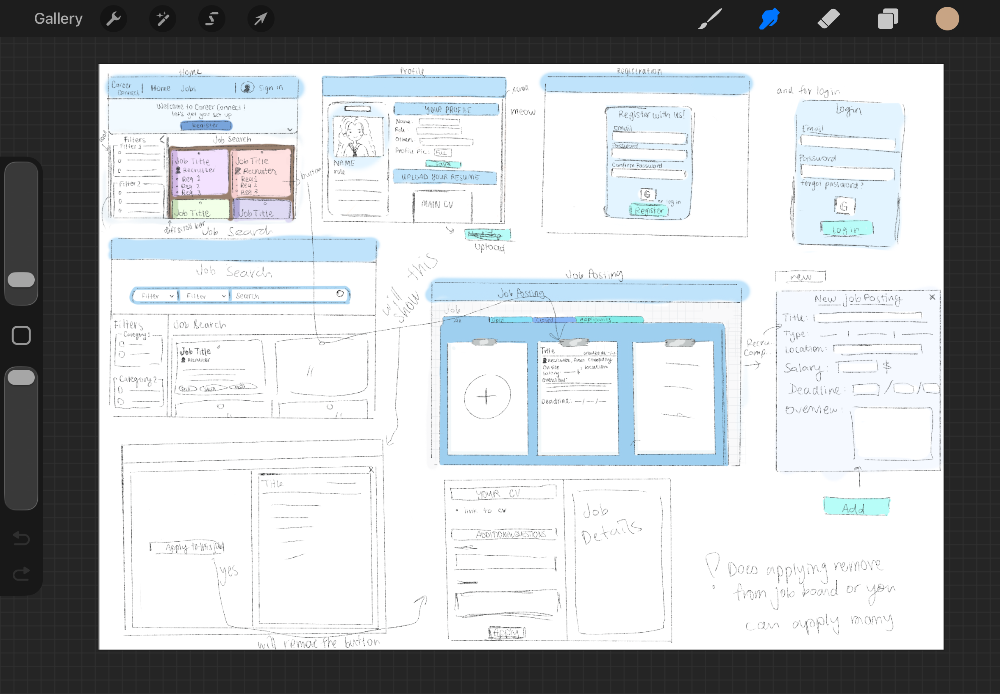

# My Contribution Log

## Activities
- Design: (3 hours)

- Front end setup for recruiter dashboard and posting management: (8hrs)
- Front end of Job Application: (4hrs)
- Front end of Job application history (4 hrs)
- Refactored the front end structure by adding modules to reuse components and styling (2-3 hours)

## Commits
[Michelle's Commits](https://github.com/Nicholas2002p/Soen341Project/commits/sprint-2/?author=uyen1dinh&before=8f1a2aeb3873430faf00a6ab9ab4ee2e857b9837+35)

## Pull Requests
[Michelle's PR](https://github.com/Nicholas2002p/Soen341Project/pulls?q=is%3Apr+state%3Aclosed+assignee%3Auyen1dinh)

## Issues Completed
[Michelle's Completed Issues](https://github.com/Nicholas2002p/Soen341Project/issues?q=is%3Aissue+state%3Aclosed+assignee%3Auyen1dinh)
